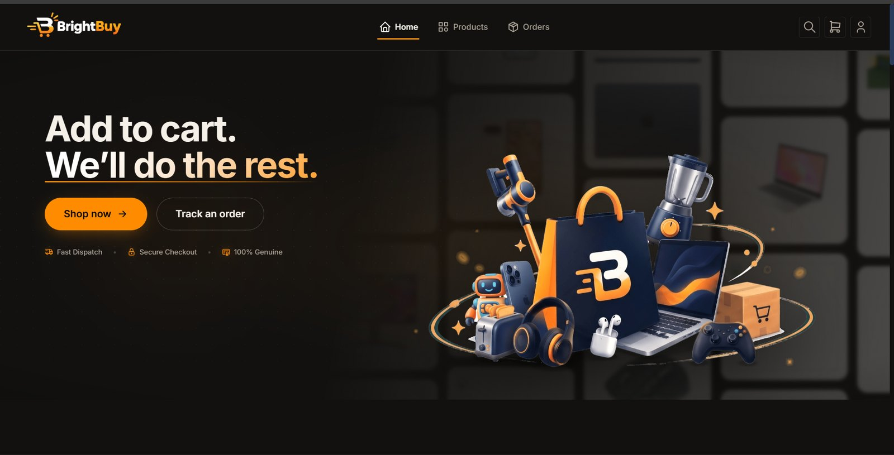
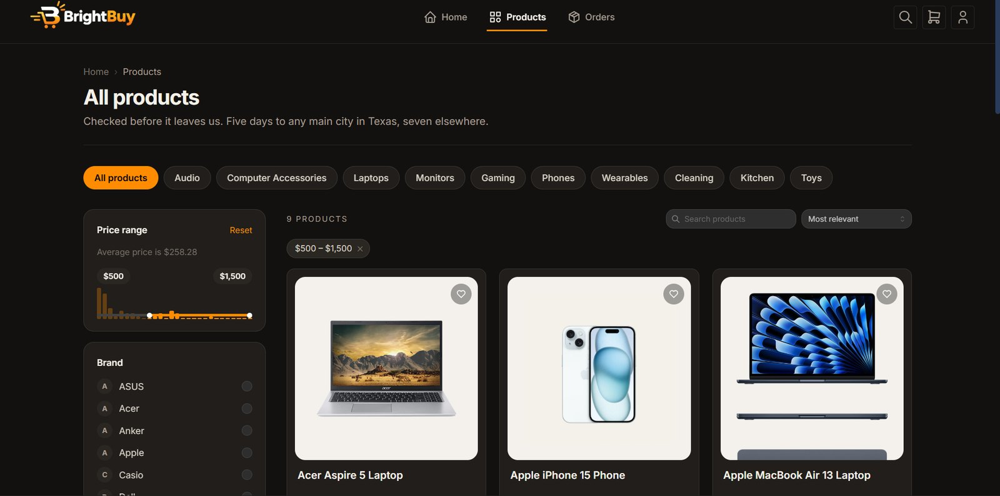
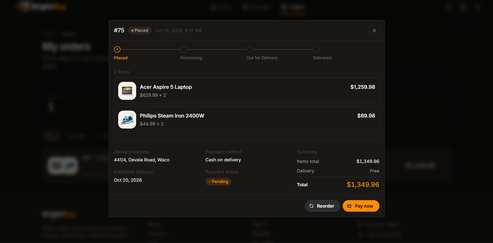

# BrightBuy — Retail Inventory & Online Order Management System

**CS3043 Database Systems · Group 13 · University of Moratuwa**

[](https://github.com/Didi255/brightbuy/actions/workflows/deploy.yml)

A digital commerce platform for a consumer electronics retail chain in Texas: product
browsing, ordering, payment and delivery scheduling, built around a relational schema that keeps
inventory and orders consistent under concurrent load.

**Live:** https://brightbuy-g13.indiasouthcentral.cloudapp.azure.com

**Stack:** MySQL 8 · Node.js + Express · React (Vite) · Docker · GitHub Actions → Azure

---

## Screenshots

**Home**


**Catalogue — category chips, brand filter, and a price histogram drawn from the real price distribution**


**Order detail — progress stepper, price and address as they were at the time of sale, payment status**


---

## Team contributions

Each member owned one vertical slice: the migrations, the stored routines, the API module and
the screens for that area. Commit history per member is under **Insights → Contributors**.

| Member | Slice | Built |
|---|---|---|
| **Dihini Kandegedara**<br>`Didi255` | **A — Orders & delivery** | `sp_place_order` (the order transaction: row locking in primary-key order, stock decrement, rollback with `RESIGNAL`), `sp_cancel_order`, `fn_estimate_delivery_days`, `trg_variant_stock_no_negative`, the `orders` / `order_item` / `delivery` schema, the 20-way concurrency harness, order history and order detail screens, the shared design system, and the Docker + CI/CD pipeline to Azure with nightly backups |
| **Maathumai**<br>`Maathumai-03` | **E — Payments, reports & staff console** | `payment` and `stock_adjustment` schema, the five report procedures (`sp_report_quarterly_sales`, `sp_report_top_products`, `sp_report_category_orders`, `sp_report_upcoming_deliveries`, `sp_report_customer_summary`), views `v_order_details` and `v_variant_stock`, the reports REST layer, the mock card gateway with the 24-hour retry window and expiry job, COD settlement by staff, and the Reports, Payment and Stock Adjustment screens |
| **Risandu**<br>`risandu26-hash` | **B — Catalogue** | `product` / `variant` / `category` / `product_category` schema, the self-referencing category hierarchy, variant attributes, catalogue search, filtering and server-side sorting, the admin catalogue endpoints, the product detail page, the staff catalogue and orders screens, and catalogue seed data |
| **Vidura Pabasara**<br>`viduraPabasara-8` | **C — Cart & checkout** | `cart` / `cart_item` schema, guest carts keyed by session token and merged on login, quantity merging, the cart, checkout and confirmation screens |
| **Ajini Rasadhika**<br>`ajini-R` | **D — Accounts & administration** | `user` / `customer` / `staff` / `address` schema, bcrypt registration and JWT login, role-based route protection, address book with ownership, `admin_audit_log`, user deactivation, and the user management and audit log screens |

---

## What is implemented

| Area | What exists | Where |
|---|---|---|
| **Order placement** | One transaction: lock, validate, write order + items + delivery, decrement stock. Back-order when stock is zero. | `007_procedures_orders.sql` |
| **Delivery estimate** | Main city 5 days, other 7, +3 if any line is out of stock. Store Pickup gets a delivery row too. | `fn_estimate_delivery_days` |
| **Cart** | Guest and customer carts, quantity merge, guest cart claimed on login. | `server/src/modules/cart` |
| **Checkout** | Delivery mode, address, payment method; the client never sends a total. | `POST /api/checkout/confirm` |
| **Payments** | Cash on Delivery, and Card through a mock gateway (`success` / `failure`). Failed card payments can be retried within 24 hours; after that the order is cancelled. | `server/src/modules/payments` |
| **Reports** | The five management reports as stored procedures, exposed under `/api/reports/*` and shown on `/staff/reports`. | `008_procedures_reports.sql` |
| **Catalogue** | Category tree, variants with attributes, search, brand and price filters, server-side sort. | `server/src/modules/catalogue` |
| **Accounts** | Register, login, profile, address book, four staff roles, audit log, deactivation. | `server/src/modules/auth`, `account` |
| **Staff console** | Order status transitions, stock adjustments, catalogue management, user management, reports. | `/staff/*` |
| **Delivery** | Docker images built in CI, pushed to GHCR, deployed to Azure over SSH; migrations applied automatically. | `.github/workflows/` |

---

## What the database does

**19 tables · 2 views · 7 stored procedures · 1 function · 1 trigger · 25 foreign keys · 4 CHECK
constraints · 16 migrations.** The catalogue seeds 13 categories and over 40 products, many with
several variants, and 21 Texas cities (6 of them main cities).

The design decisions worth knowing:

- **The variant carries price and stock, not the product.** A product with one option gets a
  single default variant, so there is no special case anywhere in the code.
- **Order placement is one transaction.** `sp_place_order` locks every variant in the cart
  **ordered by primary key** before reading anything, which makes deadlock impossible rather than
  merely unlikely. Its `EXIT HANDLER` does `ROLLBACK` **and `RESIGNAL`**, so a failure can never
  be reported to the application as a success.
- **`order_item.unit_price_at_order` and `delivery.address_snapshot`** look like denormalisation
  and are not. A sold price and a delivery address are facts about that transaction; joining to
  the live row would let a price change silently rewrite history.
- **Every order gets a `delivery` row**, store pickup included, so reporting needs no special
  case.
- **Stock cannot go negative** — validation, a guarded decrement, a `CHECK` constraint and a
  `BEFORE UPDATE` trigger, independently.
- **Card numbers, CVV and expiry are never stored.** Only the gateway reference. There is no
  column for them.
- **Money is `DECIMAL(10,2)` in SQL and a string in JSON**, so an exact decimal reaches the
  screen without ever becoming a float.

Twenty-nine design decisions, each with its reasoning and what was rejected, are recorded in
[`docs/DECISIONS.md`](docs/DECISIONS.md).

### Indexing — fewer than planned, on purpose

Seven indexes were planned and three were deliberately not created, each verified with
`SHOW INDEX` rather than assumed:

| Planned, not created | Why |
|---|---|
| `product_category(category_id)` | **InnoDB already built it.** The primary key `(product_id, category_id)` cannot serve a lookup on `category_id` alone, so the foreign key got its own index automatically. A duplicate would only slow writes. |
| `order_item(variant_id)` | Already exists as `fk_order_item_variant`, built for the foreign key. |
| `product(product_name)` | Cannot help. Search uses `LIKE '%keyword%'`, and a leading wildcard cannot seek into a B-tree. |

The indexes that **do** exist are the ones nothing creates for you:
`idx_orders_date` (quarterly sales), `idx_orders_customer` (order history, reused for the
foreign key), `idx_delivery_est_date` (upcoming deliveries), and three on `admin_audit_log`.

### Proof of concurrency safety

```bash
cd server && npm run test:concurrency
```

Twenty simultaneous orders against one unit of stock: exactly one succeeds, stock lands on zero,
nothing deadlocks. Seeding two units instead of one makes the harness fail and exit non-zero —
that negative control is what makes the passing run meaningful.

**This runs in CI on every push**, against a real MySQL 8, so the transaction cannot be weakened
without the build going red.

---

## Running it locally

```bash
git clone https://github.com/Didi255/brightbuy.git && cd brightbuy
cp .env.example .env

docker compose up -d              # MySQL 8 on host port 3307

cd server && npm install
npm run migrate                   # applies database/migrations/*.sql in order
npm run seed                      # cities, users, catalogue, 64 demo orders
npm run dev                       # API on http://localhost:4000

cd ../client && npm install
npm run dev                       # UI on http://localhost:5173
```

### Demo accounts

| Account | Password | Role |
|---|---|---|
| `admin@brightbuy.com` | `Admin@123` | staff — admin |
| `majorexec@brightbuy.com` | `Major@123` | staff — major exec |
| `sarah.brown@brightbuy.com` | `Customer@123` | customer (Lubbock — 7-day estimate) |

Seed credentials for a coursework project. They are not used anywhere else.

---

## API overview

All routes are under `/api`. Full request and response shapes are in
[`docs/API.md`](docs/API.md).

| Group | Endpoints |
|---|---|
| **Auth** | `POST /auth/register` · `POST /auth/login` |
| **Account** | `GET/PUT /me` · `GET/POST /me/addresses` · `GET /cities` |
| **Catalogue** | `GET /products` (search, brand, price, category, sort, paging) · `GET /products/:id` · `GET /categories` |
| **Cart** | `GET /cart` · `POST /cart/items` · `PATCH/DELETE /cart/items/:id` |
| **Checkout & orders** | `GET /checkout/summary` · `POST /checkout/confirm` · `GET /orders` · `GET /orders/:id` · `POST /orders/:id/cancel` |
| **Payments** | `POST /payments/card` · `POST /payments/:id/retry` · `PATCH /admin/payments/:id` |
| **Staff — operations** | `GET /admin/orders` · `PATCH /admin/orders/:id/status` · `POST /admin/stock-adjustments` |
| **Staff — catalogue** | `/admin/products` · `/admin/categories` · `/admin/variants` |
| **Staff — administration** | `GET/POST/PATCH /admin/cities` · `GET/PATCH /admin/users` · `GET /admin/audit-log` |
| **Reports** | `GET /reports/quarterly-sales` · `top-products` · `category-orders` · `upcoming-deliveries` · `customer-summary` |

---

## Layout

```
database/
  migrations/   schema, append-only — never edit a merged migration
  seeds/        reference and demo data
  tools/        asset generation scripts
server/src/modules/<slice>/
  <slice>.routes.js       URL → controller.          No logic.
  <slice>.controller.js   HTTP in/out, status codes. No SQL.
  <slice>.service.js      Business rules.            No SQL, no req/res.
  <slice>.repo.js         SQL only.
client/src/features/<slice>/   the screens for that slice
infrastructure/                Dockerfiles, production compose, Caddy, backup script
.github/workflows/             CI and the deploy pipeline
```

**SQL appears only in `*.repo.js`**, always with `?` placeholders, never string concatenation.

---

## Documentation

| | |
|---|---|
| [`docs/SCHEMA.md`](docs/SCHEMA.md) | Every table, column, type and constraint |
| [`docs/API.md`](docs/API.md) | Every endpoint and JSON shape |
| [`docs/DECISIONS.md`](docs/DECISIONS.md) | Design decisions and their reasoning |
| [`docs/DEPLOYMENT.md`](docs/DEPLOYMENT.md) | Docker, CI/CD and the Azure host, end to end |
| [`docs/UI-GUIDE.md`](docs/UI-GUIDE.md) | Design tokens, components, conventions |
| [`docs/COURSE-COVERAGE.md`](docs/COURSE-COVERAGE.md) | Where each course topic is demonstrated |

---

## Deployment

Merging to `main` triggers GitHub Actions, which builds the client, checks that the API actually
loads, applies all migrations against a real MySQL, seeds it and **runs the concurrency test**.
Only if that passes does it build two Docker images, push them to GHCR, and deploy to an Azure VM
over SSH, then smoke-test the live site.

Three containers run there: MySQL, the Express API, and Caddy serving the React build and
proxying `/api`. **Only Caddy is exposed** — the database has no published port, so it is
unreachable from the internet. Migrations run on every deploy and are idempotent; seeds are never
run automatically. A nightly `mysqldump` (with `--routines --triggers`, since the order logic
lives in stored routines) is written to the VM.

Full detail, including how to re-create the host from scratch, is in
[`docs/DEPLOYMENT.md`](docs/DEPLOYMENT.md).

---

## Known limitations

Stated here rather than discovered later.

- **No reviews or ratings.** There is no `review` table, so no star ratings appear anywhere in
  the interface.
- **No discounts.** There is no price-history model, so nothing shows a struck-through price.
- **No partial fulfilment.** An order ships whole; a partial stock shortfall rejects it, while
  zero stock becomes a back-order with three extra days.
- **Card payments use a mock gateway.** The brief asks for card as a payment method, not for a
  live processor; the adapter's response shape is what a real one would return.
- **No payment gateway webhook.** The mock gateway answers synchronously, so there is no
  asynchronous confirmation path or reconciliation job. Status changes are conditional
  `UPDATE ... WHERE payment_status = ...` statements, so a double submit changes the row once.
- **The client has no static check for undefined components or unrouted links.** CI proves the
  build and the API load; it does not lint the front end.
